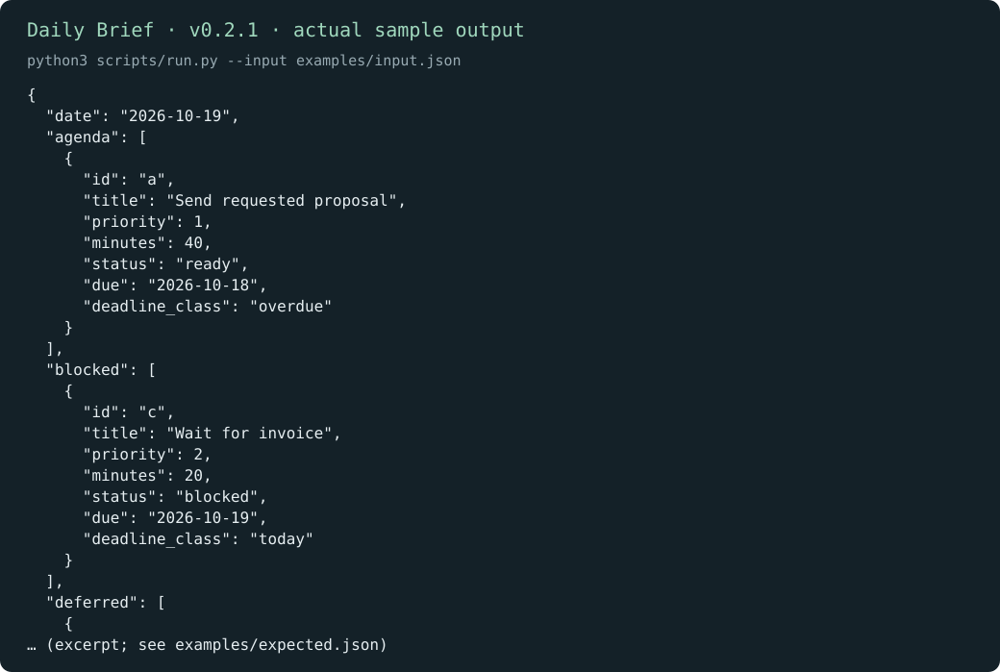
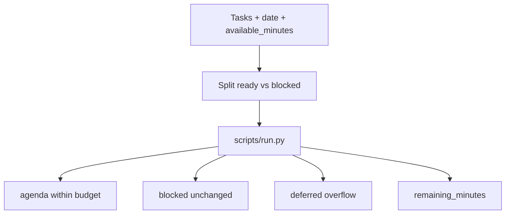

# Daily Brief

[English](README.md) · [中文](README.zh-CN.md) · **v0.2.1**

[](https://github.com/KarmenLoop/skill-daily-brief/releases/latest)
[](https://www.python.org/downloads/)
[](LICENSE)
[](skill.json)
[](SKILL.md)

**Turn task records into a realistic daily agenda—blocked work visible, ready work fitted to the minutes you have.**

Morning lists fail when every task is treated as scheduled and blocked work disappears. **Daily Brief** is a portable agent skill plus a local Python helper that takes a working date, `available_minutes`, and a task list, then emits `agenda`, `blocked`, `deferred`, and `remaining_minutes`. It is **deterministic planning**—not a calendar reader, not an AI estimator, and not an executor.

Built and maintained by [KarmenLoop](https://github.com/KarmenLoop) / [KARMENLOOP](https://karmenloop.com). Current release: **[v0.2.1](https://github.com/KarmenLoop/skill-daily-brief/releases/tag/v0.2.1)**. License: **MIT**.



*Actual local output from v0.2.1, rendered as an image. [Complete result](examples/expected.json) · [Image provenance](docs/images/provenance.json).*

[Download v0.2.1](https://github.com/KarmenLoop/skill-daily-brief/releases/tag/v0.2.1) · [Tutorial](docs/tutorial.en.md) · [中文教程](docs/tutorial.zh-CN.md) · [Input contract](docs/INPUT.md)

---

## Why this exists

Agents love optimistic packing. This package keeps unfinished and blocked work visible, refuses to infer deadlines from message arrival time, and makes capacity tradeoffs explicit when a 60-minute review cannot fit a 90-minute day.

---

## Snapshot

| | |
|---|---|
| **What you install** | Portable skill (`SKILL.md`, docs, examples) + local helper under `scripts/` |
| **Package name** | `karmen-daily-brief` |
| **Version** | **0.2.1** (`skill.json`, release tag, `--version`) |
| **Runtime** | Python **3.9+**, standard library only |
| **Network** | Helper: **offline** (`"network": false` in `skill.json`) |
| **Entry** | `python3 scripts/run.py --input …` · optional `python3 install.py --host agents` |
| **Sample artifact** | [examples/input.json](examples/input.json) → [examples/expected.json](examples/expected.json) |
| **License** | [MIT](LICENSE) — keep [NOTICE.md](NOTICE.md) with redistributed copies |

---

## Is / Is not

| Is | Is not |
|---|---|
| Capacity-aware agenda from supplied tasks | Calendar sync or reminder sender |
| Explicit blocked and deferred buckets | Silent drop of tasks that do not fit |
| Priority + deadline_class sorting under a minute budget | AI duration estimation |
| Portable skill + stdlib helper | Project management SaaS |
| Offline; no model account for the helper | Authority to notify people or start work |

---

## How it works

1. **Method layer** — read the selected task source; preserve IDs; normalize dates only when the source supplies a timezone; keep blocked items visible; do not invent deadlines.
2. **Helper** — pack ready tasks into `available_minutes` by priority / due class; emit remaining capacity.

### Flow



### Sample (v0.2.1)

With **90** minutes available: the overdue 40-minute proposal enters the agenda; the invoice stays **blocked**; the 60-minute review is **deferred**; **50** minutes remain. See [examples/expected.json](examples/expected.json).

---

## Quickstart

### A. Run the helper (no agent host required)

1. Download `karmen-daily-brief-v0.2.1.zip` and its `.sha256` from the [v0.2.1 release](https://github.com/KarmenLoop/skill-daily-brief/releases/tag/v0.2.1).
2. Verify the hash, then extract.
3. In the extracted directory, with Python 3.9+:

```sh
python3 scripts/run.py --version
python3 scripts/run.py --input examples/input.json
```

Expected version string: `karmen-daily-brief 0.2.1`. JSON lands on stdout. Use `--output new-result.json` to keep a copy without overwriting existing files. Pipe mode: `--input -`.

### B. Install the portable skill

For hosts that read `~/.agents/skills` (or a project `.agents/skills`):

```sh
python3 install.py --host agents
```

The installer **refuses an existing destination**—use a fresh path or remove the old copy first. Host discovery and invocation vary; see [docs/tutorial.en.md](docs/tutorial.en.md). You can keep using the helper directly without any AI host.

### Use it with your own work

- Choose a working `date`, realistic `available_minutes`, and honest task lengths.
- Priority **1** is highest; mark tasks `ready`, `blocked`, or `done`.
- Compare a 30-minute day with a 120-minute day on the same tasks—watch what moves to deferred.
- Do not infer a deadline from when a chat message arrived.

Read [docs/INPUT.md](docs/INPUT.md) before preparing new input. The helper needs no model account, API key, or network connection. An AI host has its own data and permission settings; this skill adds no authority to send, purchase, publish, or change access.

---

## Documentation map

| Doc | Use it when you need… |
|---|---|
| [Tutorial (EN)](docs/tutorial.en.md) · [中文](docs/tutorial.zh-CN.md) | Download, install, practice, upgrade, remove |
| [INPUT.md](docs/INPUT.md) · [input.zh-CN.md](docs/input.zh-CN.md) | Field contract |
| [COMPATIBILITY.md](docs/COMPATIBILITY.md) | Host / runtime notes |
| [VALIDATION.md](docs/VALIDATION.md) | What checks cover |
| [SOURCES.md](docs/SOURCES.md) | Provenance pointers |
| [CHANGELOG.md](CHANGELOG.md) | History through 0.2.1 |
| [SECURITY.md](SECURITY.md) / [SUPPORT.md](SUPPORT.md) / [CONTRIBUTING.md](CONTRIBUTING.md) | Ops |

---

## FAQ

### What is Daily Brief in one sentence?

A MIT-licensed agent skill and offline helper that packs supplied tasks into a minute budget and keeps blocked work visible.

### Will it send reminders?

No. Save the output or pass selected items to your own reminder tool after review.

### Does it read my calendar?

No. Capacity comes from `available_minutes` you provide.

### Does it estimate how long tasks take?

No. You supply `minutes` per task. The helper does not call a model to guess duration.

### Where does output go?

JSON to stdout by default, or `--output` to a new file.

### Soft discoverability

Useful phrases: **daily agenda from task list**, **capacity-aware day planning skill**, **blocked vs deferred task buckets**, **offline morning brief for agents**. Avoid stuffing; the substance is in the skill and helper, not keyword density.

---

## License and contact

[MIT](LICENSE). Keep the license and [NOTICE.md](NOTICE.md) with redistributed copies.

Maintainer: [KarmenLoop](https://github.com/KarmenLoop) · Site: [karmenloop.com](https://karmenloop.com)

Issues: [GitHub Issues](https://github.com/KarmenLoop/skill-daily-brief/issues) · Support policy: [SUPPORT.md](SUPPORT.md). Prefer synthetic data when filing example bugs.
