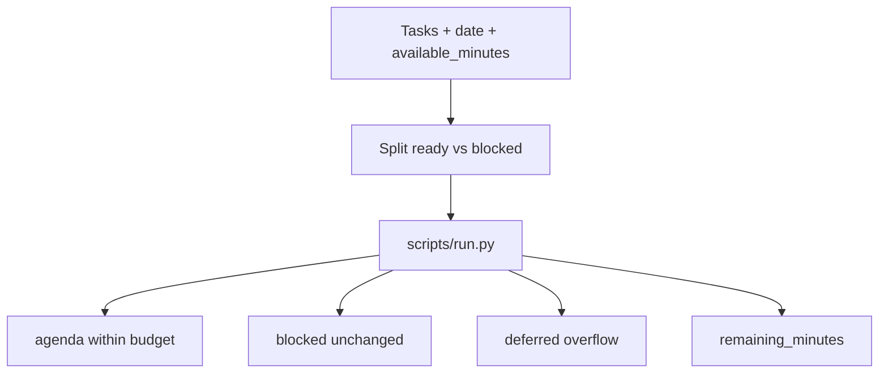

# 每日安排 · Daily Brief

[English](README.md) · [中文](README.zh-CN.md) · **v0.2.1**

[](https://github.com/KarmenLoop/skill-daily-brief/releases/latest)
[](https://www.python.org/downloads/)
[](LICENSE)
[](skill.json)
[](SKILL.md)

**用已有任务整理今天能做的事：受阻事项单独列出，已就绪任务按可用分钟数安排。**

把每件事都当成已排进日程、又把受阻事项藏起来时，早间清单就会失真。**每日安排**是可移植的 Agent Skill，外加本地 Python 助手：读取工作日、`available_minutes` 与任务列表，输出 `agenda`、`blocked`、`deferred` 与 `remaining_minutes`。这是**按规则的计划工具**——不读日历、不用模型估时、也不执行安排。

由 [KarmenLoop](https://github.com/KarmenLoop) / [KARMENLOOP](https://karmenloop.com) 维护。当前发行版：**[v0.2.1](https://github.com/KarmenLoop/skill-daily-brief/releases/tag/v0.2.1)**。许可：**MIT**。


*图片来自 v0.2.1 的真实本地输出（英文键名）。[完整结果](examples/expected.json) · [图片来源记录](docs/images/provenance.json)。*

[下载 v0.2.1](https://github.com/KarmenLoop/skill-daily-brief/releases/tag/v0.2.1) · [中文教程](docs/tutorial.zh-CN.md) · [English tutorial](docs/tutorial.en.md) · [输入契约](docs/input.zh-CN.md)

---

## 为什么需要它

代理喜欢乐观塞满。本包让未完成与受阻工作保持可见，拒绝用消息到达时间推断截止日期，并在 60 分钟审阅塞不进 90 分钟可用时，把取舍说清楚。

---

## 一览

| | |
|---|---|
| **安装内容** | 可移植 Skill（`SKILL.md`、文档、样例）+ `scripts/` 下本地助手 |
| **包名** | `karmen-daily-brief` |
| **版本** | **0.2.1**（`skill.json`、发行标签、`--version`） |
| **运行时** | Python **3.9+**，仅标准库 |
| **网络** | 助手：**离线**（`skill.json` 中 `"network": false`） |
| **入口** | `python3 scripts/run.py --input …` · 可选 `python3 install.py --host agents` |
| **样例产物** | [examples/input.json](examples/input.json) → [examples/expected.json](examples/expected.json) |
| **许可** | [MIT](LICENSE) — 再分发时保留 [NOTICE.md](NOTICE.md) |

---

## 是 / 不是

| Is | Is not |
|---|---|
| 按你提供的任务做容量感知的当日安排 | 日历同步或提醒发送 |
| 明确的受阻与延后分组 | 塞不下就悄悄丢掉任务 |
| 在分钟预算下按优先级与截止日期类排序 | 用 AI 估算工时 |
| 可移植 Skill + 标准库助手 | 项目管理 SaaS |
| 助手离线，不需要模型账号 | 通知他人或开工的授权 |

---

## 如何工作

1. **方法层** — 读取选定任务源并保留 ID；仅在源提供时区时规范化日期；受阻项保持可见；不捏造截止日期。
2. **助手** — 按优先级 / 截止类别把就绪任务装进 `available_minutes`；输出剩余容量。

### 流程



### 样例（v0.2.1）

**90** 分钟可用时：逾期的 40 分钟提案进入安排；发票事项保持 **blocked**；60 分钟审阅进入 **deferred**；剩余 **50** 分钟。详见 [examples/expected.json](examples/expected.json)。

---

## 快速开始

### A. 直接跑助手（不需要 AI 宿主）

1. 从 [v0.2.1 发行页](https://github.com/KarmenLoop/skill-daily-brief/releases/tag/v0.2.1) 下载 `karmen-daily-brief-v0.2.1.zip` 与对应 `.sha256`。
2. 核对哈希后解压。
3. 在解压目录中使用 Python 3.9+：

```sh
python3 scripts/run.py --version
python3 scripts/run.py --input examples/input.json
```

期望版本字符串：`karmen-daily-brief 0.2.1`。JSON 默认输出到 stdout。用 `--output new-result.json` 落盘且不覆盖已有文件。管道：`--input -`。

### B. 安装可移植 Skill

若宿主读取 `~/.agents/skills`（或项目内 `.agents/skills`）：

```sh
python3 install.py --host agents
```

安装器**拒绝已存在的目标目录**——请换新路径或先移除旧副本。宿主发现与调用方式因环境而异；见 [docs/tutorial.zh-CN.md](docs/tutorial.zh-CN.md)。也可以完全不装宿主，只跑助手。

### 用于你自己的工作

- 选定工作 `date`、真实的 `available_minutes` 与诚实的任务时长。
- 优先级 **1** 最高；任务标记为 `ready`、`blocked` 或 `done`。
- 用同一批任务对比 30 分钟日与 120 分钟日——观察什么进入 deferred。
- 不要用聊天消息到达时间推断截止日期。

准备新输入前请阅读 [docs/input.zh-CN.md](docs/input.zh-CN.md) / [docs/INPUT.md](docs/INPUT.md)。助手不需要模型账号、API 密钥或网络。AI 宿主有自己的数据与权限设定；本 Skill **不**额外授予发送、购买、发布或改权限的权力。

---

## 文档地图

| 文档 | 用途 |
|---|---|
| [中文教程](docs/tutorial.zh-CN.md) · [English](docs/tutorial.en.md) | 下载、安装、练习、升级、移除 |
| [input.zh-CN.md](docs/input.zh-CN.md) · [INPUT.md](docs/INPUT.md) | 字段契约 |
| [COMPATIBILITY.md](docs/COMPATIBILITY.md) | 宿主 / 运行时说明 |
| [VALIDATION.md](docs/VALIDATION.md) | 校验覆盖范围 |
| [SOURCES.md](docs/SOURCES.md) | 来源与溯源 |
| [CHANGELOG.md](CHANGELOG.md) | 至 0.2.1 的历史 |
| [SECURITY.md](SECURITY.md) / [SUPPORT.md](SUPPORT.md) / [CONTRIBUTING.md](CONTRIBUTING.md) | 运维 |

---

## 常见问题

### 一句话：每日安排是什么？

MIT 许可的 Agent Skill 与离线助手：把你提供的任务装进分钟预算，并让受阻工作保持可见。

### 会发提醒吗？

不会。审阅后自行保存输出，或把选定项交给你自己的提醒工具。

### 会读我的日历吗？

不会。容量来自你提供的 `available_minutes`。

### 会估算任务要多久吗？

不会。每项任务的 `minutes` 由你提供。助手不会调用模型猜时长。

### 结果写到哪里？

默认 stdout JSON，或 `--output` 写入新文件。

### 温和可发现性

可用检索说法：**由任务列表生成当日安排**、**容量感知的日程规划 Skill**、**受阻与延后任务分组**、**面向代理的离线早间简报**。 避免堆砌；实质在 Skill 与助手里，不在关键词密度。

---

## 许可与联系

[MIT](LICENSE)。再分发时请保留许可证与 [NOTICE.md](NOTICE.md)。

维护者：[KarmenLoop](https://github.com/KarmenLoop) · 站点：[karmenloop.com](https://karmenloop.com)

问题反馈：[GitHub Issues](https://github.com/KarmenLoop/skill-daily-brief/issues) · 支持政策：[SUPPORT.md](SUPPORT.md)。提交样例相关问题时请优先使用合成数据。
